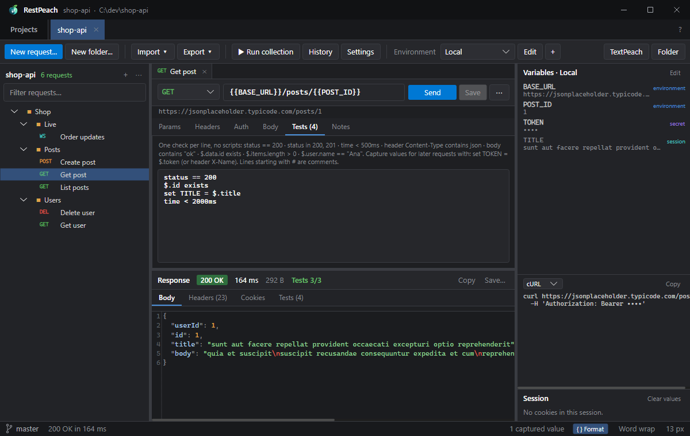
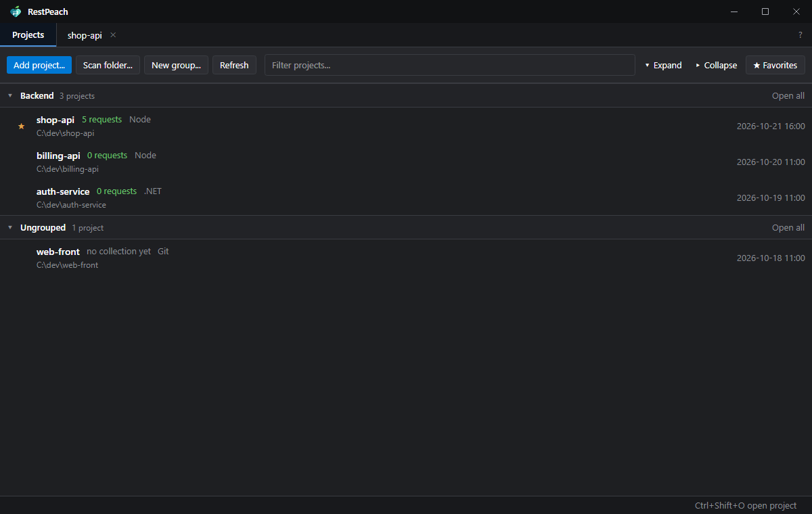
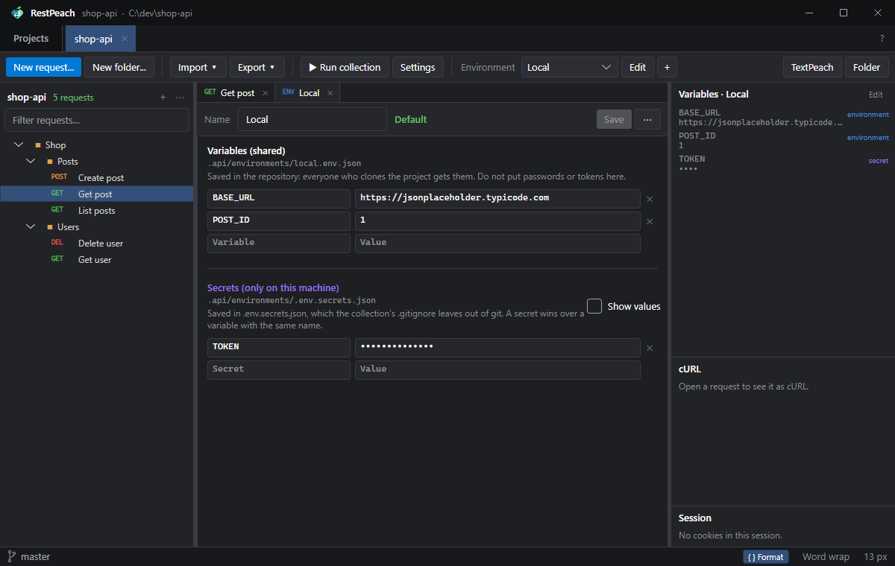
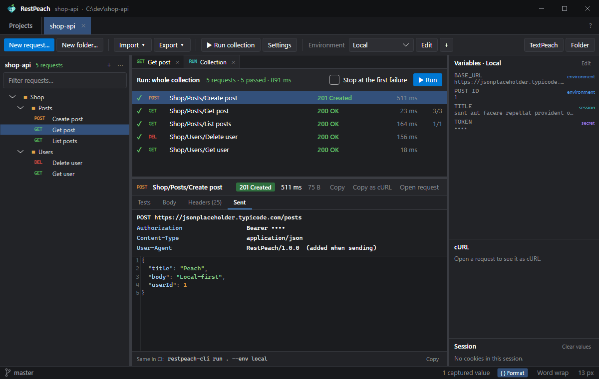

<p align="center">
  
</p>

<h1 align="center">RestPeach</h1>

<p align="center">
  API client for Windows, <b>local-first and git-native</b>.<br/>
  Requests live in your repository as text files: send them, test them, review them in the diff and run them in CI, with no accounts and no cloud.
</p>

<p align="center">
  <a href="README.md">Español</a> · <b>English</b>
</p>

<p align="center">
  
</p>

---

## Contents

- [Why RestPeach?](#why-restpeach)
- [Screenshots](#screenshots)
- [Features](#features)
- [Requirements and installation](#requirements-and-installation)
- [Getting started](#getting-started)
- [How it works](#how-it-works)
  - [The collection is a folder](#the-collection-is-a-folder)
  - [Variables and environments](#variables-and-environments)
  - [Inherited auth](#inherited-auth)
  - [Declarative tests](#declarative-tests)
  - [Running the collection](#running-the-collection)
  - [Import and export](#import-and-export)
  - [Git and the Peach family](#git-and-the-peach-family)
- [Command line (CI)](#command-line-ci)
- [Keyboard shortcuts](#keyboard-shortcuts)
- [Data, privacy and portable mode](#data-privacy-and-portable-mode)
- [Known limits](#known-limits)
- [Building from source](#building-from-source)
- [Repository layout](#repository-layout)
- [Contributing](#contributing)
- [License and credits](#license-and-credits)

---

## Why RestPeach?

The best-known API clients keep collections in their cloud or in a database of their own. Sharing them means
inviting people to a *workspace*, and when a backend endpoint changes, the collection gets updated somewhere
else, at some other time, with no review.

RestPeach turns that around:

- **The disk is the source of truth.** The collection is the `.api/` folder of your project: one folder per
  group and **one text file per request**. No hidden databases.
- **It is reviewed like code.** Files are JSON with sorted keys and a stable layout, so a changed endpoint
  shows up cleanly in the diff of the same *pull request* that changes the backend.
- **Secrets stay home.** Shared variables go to the repository; tokens and passwords stay in a file git
  ignores and that never leaves your machine.
- **Tests without scripts.** One check per line (`status == 200`, `$.data.id exists`,
  `set TOKEN = $.token`), readable in a diff and with no JavaScript engine.
- **Same in CI.** `restpeach-cli run` runs the collection exactly like the app: same variables, same auth,
  same tests. It exits with 0 or 1.
- **Easy to switch.** Imports Postman 2.1, Insomnia 4, OpenAPI 3.x and cURL commands.

A new teammate clones the repository, opens the folder and already has every endpoint with its variables.
No invitations, no accounts, no telemetry. A single portable `.exe`, in English and Spanish.

## Screenshots

| | |
|---|---|
|  |  |
| **Projects:** groups, favorites, how many requests each one has and its type. | **Environments:** variables that go to the repository and secrets that stay on your machine. |

<p align="center">
  <br/>
  <sub><b>Run the collection:</b> results in order and, when you pick one, its tests, the response and what was actually sent.</sub>
</p>

## Features

| Area | What it includes |
|---|---|
| **Projects** | Persistent list, favorites ★, collapsible groups (shared with the rest of the Peach family), folder scan, drag and drop, several open tabs restored on restart. |
| **Requests** | GET, POST, PUT, PATCH, DELETE, HEAD, OPTIONS. Params kept in sync with the URL, headers, JSON / GraphQL (query + variables) / text / XML / HTML / form-data (with files) / x-www-form-urlencoded bodies, notes. GraphQL, JSON-RPC and SOAP are recognized (GQL, RPC, SOAP in the tree) and the response is explained in their terms: errors with status 200, Faults, SSE events. Pasting a cURL command into the URL imports it. |
| **Response** | Status, time and size; highlighted and formatted body (JSON and XML), images, headers, cookies; search (Ctrl+F); copy and save. |
| **Variables** | `{{NAME}}` in layers: collection < folders < environment < secrets < values captured in the session. Dynamic: `{{$guid}}`, `{{$timestamp}}`, `{{$isoTimestamp}}`, `{{$randomInt}}`. Side panel with where each value comes from. |
| **Auth** | Inherit, none, Bearer, Basic, API key (header or query). Set it on the collection or on a folder and the requests below inherit it. |
| **Tests** | Declarative, one per line, on status, time, size, headers, body and JSONPath; `set` captures to chain requests. |
| **Runs** | A folder or the whole collection, in order, with "stop at the first failure". Each result shows its tests, the response (body and headers) and what was sent (final URL, headers, body). |
| **Import** | Postman 2.1, Insomnia 4, OpenAPI 3.0/3.1 (JSON or YAML), cURL. Keeps the order of the collection, turns the usual Postman tests (`pm.expect(...)`, `pm.collectionVariables.set`) into declarative tests and reports what could not be kept (pre-request scripts, unsupported auth…). |
| **Export** | Postman collection, OpenAPI document and a bash script with `curl`. Any request copies as cURL (Ctrl+Shift+C). |
| **Git** | Branch and changes inside `.api/` in the status bar; proper `.gitignore` and `.gitattributes` from the start. Git actions are left to GitPeach. |
| **Disk** | A watcher reloads the tree and environments when something changes outside (a `git pull`, another editor, an AI agent). |
| **CLI** | `restpeach-cli run / import / export / envs / init` for CI and scripts. |

## Requirements and installation

- Windows 10 or 11 (x64). Nothing else: the `.exe` is self-contained (no .NET install needed).
- Download `RestPeach.exe` (and `restpeach-cli.exe` if you will use it in CI) and run it. There is no installer.

## Getting started

1. Open `RestPeach.exe` and click **Add project…** (or drop a folder on the window).
2. If the project has no collection yet, RestPeach offers to create it: it writes `.api/config.json`, the
   `local` environment, the `.gitignore` for secrets and a `.gitattributes`.
3. **New request** (Ctrl+N), type the URL and click **Send** (Ctrl+Enter). **Save** (Ctrl+S) writes it to
   disk as `.api/<folder>/<name>.req.json`.
4. Already have a Postman collection or an OpenAPI document? **Import** it.
5. Commit `.api/` together with your code.

## How it works

### The collection is a folder

```
my-project/
└── .api/
    ├── config.json                  name, default environment, collection auth and variables, timeout…
    ├── .gitignore                   keeps environments/.env.secrets.json out
    ├── .gitattributes               pins LF so the diff is the same on every machine
    ├── environments/
    │   ├── local.env.json           shared variables of the "local" environment
    │   ├── staging.env.json
    │   └── .env.secrets.json        secrets of every environment (this machine only)
    └── Shop/
        ├── folder.json              auth and variables for everything below (optional)
        ├── Posts/
        │   ├── Create post.req.json
        │   └── Get post.req.json
        └── Users/
            └── Get user.req.yaml    YAML works too
```

Folders are real folders and each request is a file. Renaming, moving or deleting in the tree renames, moves
or deletes on disk. A request looks like this:

```json
{
  "method": "GET",
  "name": "Get post",
  "url": "{{BASE_URL}}/posts/{{POST_ID}}",
  "tests": [
    "status == 200",
    "$.id exists",
    "set TITLE = $.title"
  ]
}
```

The full format, field by field, is in [docs/FORMATO.md](docs/FORMATO.md) (Spanish).

### Variables and environments

`{{NAME}}` is replaced with the value of the highest layer that defines it:

1. collection variables (`config.json`)
2. variables of each folder, outer to inner (`folder.json`)
3. the selected environment (`environments/<name>.env.json`)
4. its secrets (`environments/.env.secrets.json`)
5. values captured by earlier requests in this session (`set TOKEN = …`)

The **Variables** panel shows each value and where it comes from; secrets show as `••••` everywhere (panel,
cURL preview, run detail). An undefined variable is left as written and reported below the URL.

### Inherited auth

`config.json` and each `folder.json` can define an auth (Bearer, Basic or API key). A request whose auth is
**Inherit** uses the one of its nearest folder that has one, or the collection's. So the token is set once
(`{{TOKEN}}`, stored as a secret) and works everywhere.

### Declarative tests

One check per line, in the request's **Tests** tab:

```
status == 200                  status in 200, 201             status == 2xx
time < 500ms                   size < 10000
header Content-Type contains json                             header X-Request-Id exists
body contains "ok"             body matches ^\{
$.data.id exists               $.items.length > 0             $.user.name == "Ana"
set TOKEN = $.data.token       set SESSION = header X-Session
# lines starting with # or // are comments
```

`set` lines capture a value for the following requests: log in once and use `{{TOKEN}}` in all the others.

### Running the collection

**Run collection** (Ctrl+Shift+R), or a folder's menu, sends its requests in order, the way the CLI will.
Each row says whether it passed (✓ / ✗), the status, the time and how many tests passed. Pick a row and its
detail appears below:

- **Tests:** every check with what was found, or the error when nothing came back.
- **Body** and **Headers:** the response, formatted as in the request tab.
- **Sent:** the request as it went out: method and final URL, every header (inherited auth and the ones
  added when sending included) and the body with variables already replaced.

When the run ends, the first failure is selected. Double click (or Enter) opens the request to fix it. A
request without tests passes when a response with a status below 400 arrives. The equivalent CI command is
shown at the bottom.

### Import and export

**Import** takes a file (Postman 2.1, Insomnia 4, OpenAPI 3.0/3.1 in JSON or YAML) or a pasted cURL command.
What gets imported is written to a new folder (nothing is ever overwritten) and existing environments only
receive the variables they lack. What could not be kept is listed at the end.

**Export** produces a Postman collection, an OpenAPI document or a bash script with `curl` that reads the
variables from the environment (`${BASE_URL}`).

### Git and the Peach family

RestPeach **never runs git commands that write**. It shows the branch and the changes inside `.api/` in the
status bar; clicking the branch opens [GitPeach](https://github.com/rileydev23/gitpeach) on that repository.
The **TextPeach** button opens the request (or the project) in
[TextPeach](https://github.com/rileydev23/textpeach) to read it calmly.

The three apps share the design, the project groups and the `%APPDATA%\peachapps\` folder, where each one
announces where it is installed (`location.json`). That is how they find each other with no installers or
registry. Opening a folder from another app of the family opens it in the RestPeach window already running.

## Command line (CI)

```
restpeach-cli run [path] [--env name] [--bail] [--filter text] [--var NAME=value] [--timeout ms] [--verbose]
restpeach-cli import <file> [--project path] [--into folder]
restpeach-cli export <postman|openapi|bash> [path] [-o file]
restpeach-cli envs [path]
restpeach-cli init [path]
```

`[path]` is a project, its `.api` folder, a folder inside it or a single request (default: the current
folder). Exit code: **0** when everything passed, **1** when something failed, **2** for usage errors.
Language: `RESTPEACH_LANG=en|es`. No colors: `--no-color` or `NO_COLOR`.

In CI, pass secrets with `--var` from the pipeline's protected variables:

```yaml
# GitHub Actions
- name: Test the API
  run: restpeach-cli run . --env staging --var TOKEN=${{ secrets.API_TOKEN }} --bail
```

## Keyboard shortcuts

| General | |
|---|---|
| Ctrl+P | Go to request (in a project) / open project |
| Ctrl+Shift+O | Open project (quick search) |
| Ctrl+Tab / Ctrl+Shift+Tab | Next / previous tab |
| Ctrl+1 … Ctrl+9 | Go to tab N |
| Ctrl+W / Ctrl+F4 | Close the document (or the project if none is open) |
| F1 | About and keyboard shortcuts |

| In a project | |
|---|---|
| Ctrl+Enter | Send the request / run again |
| Ctrl+S / Ctrl+Shift+S | Save / save all |
| Ctrl+L | Go to the URL |
| Ctrl+N / Ctrl+Shift+N | New request / new folder |
| Ctrl+D | Duplicate the request |
| Ctrl+Shift+C | Copy as cURL |
| Ctrl+F (F3 / Shift+F3) | Find in the body or the response |
| Ctrl+Shift+E | Filter the tree |
| F2 / Del | Rename / delete (in the tree) |
| Ctrl+Shift+R | Run the collection |
| Ctrl+PageDown / PageUp | Next / previous document |
| Ctrl + / Ctrl − / Ctrl+0 | Text zoom |
| Alt+Z | Word wrap |
| F5 | Re-read the collection, environments and git state |

## Data, privacy and portable mode

- **No network but your requests.** RestPeach has no accounts, telemetry, auto-updates or sync. The only
  connection it makes is the request you send.
- **Your collections** are in your repositories. **The app's settings** (projects, groups, tabs, window size,
  language) are in `%APPDATA%\peachapps\RestPeach\state.json`.
- **Cookies and captured values:** each open collection keeps its own cookie jar and `set` values in memory;
  they are never written to disk. Clear them from the **Session** panel, or close the project.
- **Portable mode:** create a `portable.txt` file next to the `.exe` and settings are stored in `.\data`
  beside it, leaving `%APPDATA%` alone.

## Known limits

| What | Limit | What happens |
|---|---|---|
| Response body | 64 MB | Cut and marked as truncated. |
| Text shown | 16 MB | The rest is not shown (it can be saved in full). |
| Default timeout | 30 s | Configurable in the collection's **Settings** or with `--timeout`. |

Also: no pre/post-request scripts (on purpose: tests are declarative), no WebSockets, gRPC or schema-aware
GraphQL; changing the language needs a restart; only published for Windows x64 (Avalonia is cross-platform, so
a port is possible).

## Building from source

```bat
git clone https://github.com/rileydev23/restpeach.git RestPeach
cd RestPeach

dev.cmd                       :: builds Debug and runs it
dotnet test RestPeach.sln     :: runs the tests
build.cmd                     :: produces dist\RestPeach.exe and dist\restpeach-cli.exe
```

`build.cmd` publishes the app with ReadyToRun and compression, without trimming (TextMate grammars are loaded
through reflection), and the CLI trimmed so it stays small. Requires the .NET 10 SDK.

**Keyboard-free debugging:** in Debug, the `RESTPEACH_DEBUG_ACTIONS` variable runs actions on startup, e.g.
`open:Shop/Posts/Get post.req.json;send;run;pick:0;detail:sent;env;about`. Handy for screenshots.

## Repository layout

```
RestPeach/
├── build.cmd · dev.cmd · RestPeach.sln
├── docs/
│   ├── ARQUITECTURA.md      layers, flow of a request, technical decisions
│   ├── FORMATO.md           file format of the collection
│   ├── DISENO.md            the family design system, with RestPeach's annex
│   └── img/                 screenshots (Spanish; English in img/en/)
├── src/
│   ├── RestPeach.Core/      no UI: model, storage, variables, HTTP, tests, importers and exporters,
│   │                        Runner, texts (Strings)
│   ├── RestPeach.Cli/       restpeach-cli
│   └── RestPeach/           the desktop app (Avalonia): Services, ViewModels, Views, Controls
└── tests/RestPeach.Tests/   xUnit: format, variables, cURL, tests, import/export, real HTTP, app
```

## Contributing

Contributions are welcome!

1. Open an *issue* describing the problem or the proposal (with screenshots if it is visual).
2. *Fork*, create a branch and send a small, focused *pull request*.
3. Before sending it: `dotnet build` with no errors and `dotnet test` green. New logic goes in
   `RestPeach.Core` and comes with tests.

Conventions:

- **Every visible text goes in `RestPeach.Core/Strings.cs`** in English and Spanish (neutral Spanish, `tú`,
  sentence case). XAML uses `{l:L key}` and C# `Loc.T("key")`. **Code, names and comments in English.**
- Collection files must stay **deterministic** (sorted keys, no empty fields, LF): saving without changes
  must not produce a diff. Unknown fields are kept.
- Follow [docs/DISENO.md](docs/DISENO.md) and the family design system.
- **Never** accounts, cloud sync, telemetry, built-in AI assistants or artificial limits.

## License and credits

Copyright © 2026 [rileydev23](https://github.com/rileydev23). RestPeach is free software under the
**[GNU General Public License v3.0](LICENSE)** or later (GPL-3.0-or-later), the same license as the whole Peach
family. In short: use it for free, for anything, companies included; you can change it and share your version
as long as it is GPLv3 too, with its source code available and the copyright notices kept; nobody can ship it
as closed software. Need a closed version? Contact [rileydev23](https://github.com/rileydev23) for a
commercial license.

**Name and logo:** the GPL covers the code, not the brand. "RestPeach" and its logo identify the official
version; if you publish a fork, give it another name and logo. The binding text is the one in
[LICENSE](LICENSE).

Built with:

- [Avalonia UI](https://avaloniaui.net/) (MIT)
- [AvaloniaEdit](https://github.com/AvaloniaUI/AvaloniaEdit) and AvaloniaEdit.TextMate (MIT)
- [TextMateSharp](https://github.com/danipen/TextMateSharp) and its grammars (MIT; grammars under their own licenses, mostly MIT)
- [CommunityToolkit.Mvvm](https://github.com/CommunityToolkit/dotnet) (MIT)
- [YamlDotNet](https://github.com/aaubry/YamlDotNet) (MIT)

---

<p align="center"><i>Your APIs, in your repository, reviewed like code.</i></p>
