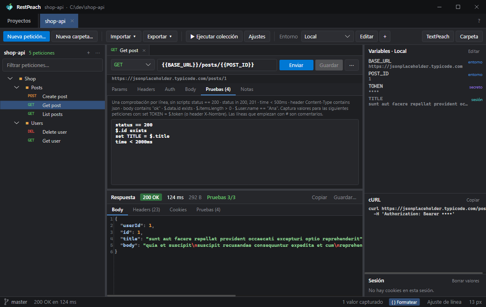
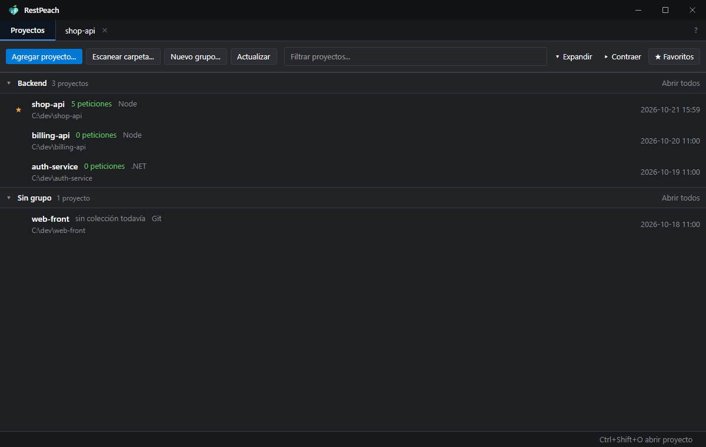
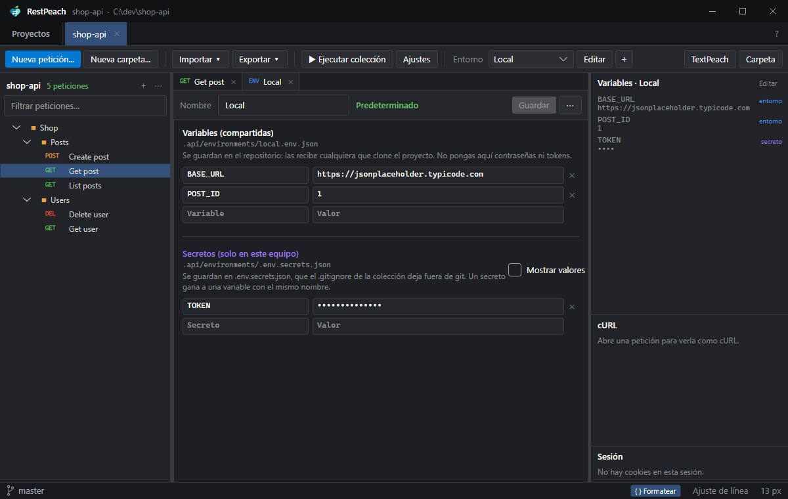
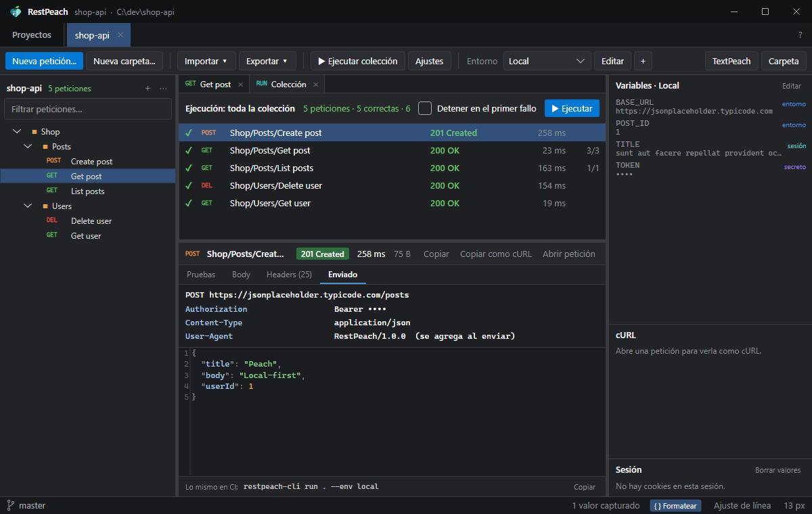
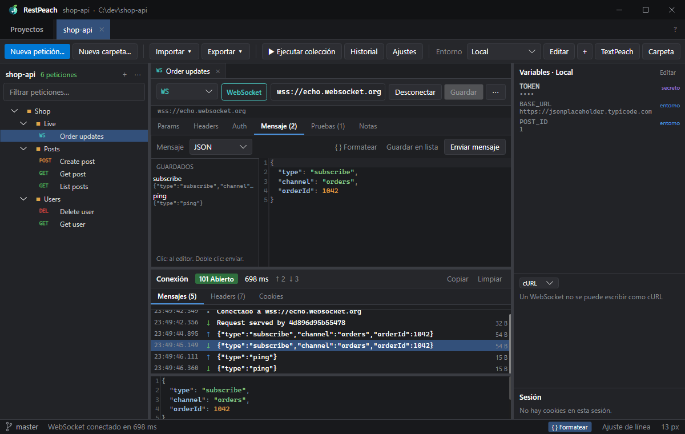
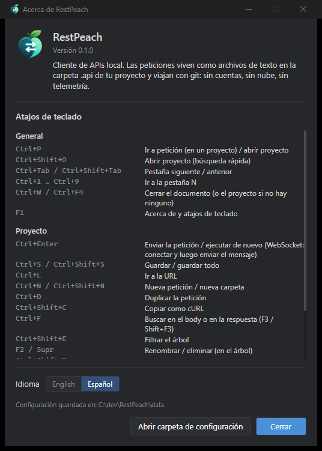

<p align="center">
  
</p>

<h1 align="center">RestPeach</h1>

<p align="center">
  Cliente de APIs para Windows y Linux, <b>local y nativo de git</b>.<br/>
  Las peticiones viven en tu repositorio como archivos de texto: se envían, se prueban, se revisan en el diff y se ejecutan en CI, sin cuentas ni nube.
</p>

<p align="center">
  <b>Español</b> · <a href="README.en.md">English</a>
</p>

<p align="center">
  
</p>

---

## Índice

- [¿Por qué RestPeach?](#por-qué-restpeach)
- [Capturas](#capturas)
- [Características](#características)
- [Requisitos](#requisitos)
- [Instalación](#instalación)
- [Primeros pasos](#primeros-pasos)
- [Cómo funciona](#cómo-funciona)
  - [La colección es una carpeta](#la-colección-es-una-carpeta)
  - [Variables y entornos](#variables-y-entornos)
  - [Autenticación heredada](#autenticación-heredada)
  - [Pruebas declarativas](#pruebas-declarativas)
  - [Ejecutar la colección](#ejecutar-la-colección)
  - [Importar y exportar](#importar-y-exportar)
  - [Git y la familia Peach](#git-y-la-familia-peach)
- [Línea de comandos (CI)](#línea-de-comandos-ci)
- [Atajos de teclado](#atajos-de-teclado)
- [Datos, privacidad y modo portable](#datos-privacidad-y-modo-portable)
- [Límites conocidos](#límites-conocidos)
- [Compilar desde el código](#compilar-desde-el-código)
- [Estructura del repositorio](#estructura-del-repositorio)
- [Contribuir](#contribuir)
- [Versiones y releases](#versiones-y-releases)
- [Licencia y créditos](#licencia-y-créditos)

---

## ¿Por qué RestPeach?

Los clientes de APIs más conocidos guardan las colecciones en su nube o en una base de datos propia. Para
compartirlas hay que invitar gente a un *workspace*, y cuando cambia un endpoint del backend, la colección
se actualiza en otro lado, en otro momento y sin revisión.

RestPeach invierte eso:

- **La fuente de la verdad es el disco.** La colección es la carpeta `.api/` de tu proyecto: una carpeta por
  grupo y **un archivo de texto por petición**. Nada de bases de datos ocultas.
- **Se revisa como el código.** Los archivos son JSON con claves ordenadas y formato estable, así que un
  cambio en un endpoint se ve limpio en el diff del mismo *pull request* que cambia el backend.
- **Los secretos no viajan.** Las variables compartidas van al repositorio; los tokens y contraseñas quedan en
  un archivo que git ignora y que nunca sale de tu equipo.
- **Pruebas sin scripts.** Una comprobación por línea (`status == 200`, `$.data.id exists`,
  `set TOKEN = $.token`), legible en un diff y sin un motor de JavaScript.
- **Lo mismo en CI.** `restpeach-cli run` ejecuta la colección exactamente como la app: mismas variables,
  misma auth, mismas pruebas. Devuelve 0 o 1.
- **Sin fricción para llegar.** Importa Postman 2.1, Insomnia 4, OpenAPI 3.x y comandos cURL.

Un nuevo integrante clona el repositorio, abre la carpeta y ya tiene todos los endpoints con sus variables.
Sin invitaciones, sin cuentas, sin telemetría. Es un único ejecutable portable (o con instalador), en español y
en inglés.

## Capturas

| | |
|---|---|
|  |  |
| **Proyectos:** grupos, favoritos, cuántas peticiones tiene cada uno y su tipo. | **Entornos:** variables que van al repositorio y secretos que se quedan en tu equipo. |

<p align="center">
  <br/>
  <sub><b>Ejecutar la colección:</b> resultados en orden y, al elegir uno, sus pruebas, la respuesta y lo que se envió de verdad.</sub>
</p>

| | |
|---|---|
|  |  |
| **WebSockets:** mensajes guardados con la petición y el registro de lo enviado ↑ y recibido ↓. | **Acerca de (F1):** atajos de teclado, idioma y dónde se guarda la configuración. |

## Características

| Área | Qué incluye |
|---|---|
| **Proyectos** | Lista persistente, favoritos ★, grupos plegables (compartidos con el resto de la familia Peach), escaneo de carpetas, arrastrar y soltar, varias pestañas que se restauran al reiniciar. |
| **Peticiones** | GET, POST, PUT, PATCH, DELETE, HEAD, OPTIONS. Params sincronizados con la URL, headers, body JSON / GraphQL (query + variables) / texto / XML / HTML / form-data (con archivos) / x-www-form-urlencoded / archivo binario, notas. GraphQL, JSON-RPC y SOAP se reconocen (GQL, RPC, SOAP en el árbol) y la respuesta se explica en sus términos: errores con status 200, Faults, eventos SSE. GraphQL: **Cargar esquema** (introspección) y Ctrl+Espacio completa los campos del tipo donde está el cursor. Pegar un comando cURL en la URL lo importa. |
| **Server-Sent Events** | Una respuesta `text/event-stream` se ve llegar en vivo, evento por evento, en la pestaña **Eventos**; Cancelar la corta y se queda lo recibido. Las pruebas ven los eventos como un array JSON (`$[0].data.id`, `$.length`). |
| **WebSockets** | Método **WS** (o una URL `ws://` / `wss://`): Conectar, enviar mensajes (con `{{variables}}`) y ver el registro de lo enviado ↑ y recibido ↓ con hora y tamaño; el mensaje elegido se ve completo y con formato. Mensajes guardados con la petición para reenviarlos con doble clic. Headers, auth y cookies van en el handshake; el código de cierre del servidor se muestra. Al ejecutar la colección se conecta, envía el mensaje, junta las respuestas y evalúa las pruebas sobre ellas. |
| **Respuesta** | Estado, tiempo y tamaño; body con colores y formato (JSON y XML), imágenes, headers, cookies; cada redirección seguida (status, destino, tiempo); búsqueda (Ctrl+F); copiar y guardar. |
| **Historial** | Cada petición enviada, con su respuesta y sus pruebas (Ctrl+H). Se guarda en la carpeta de datos de la app, nunca en el proyecto, con los secretos tapados. |
| **Conexión** | Por colección: proxy (del sistema, ninguno o manual, también SOCKS5), certificado de cliente para TLS mutuo (.pfx o PEM) y HTTP/1.1, HTTP/2 o HTTP/3. |
| **Variables** | `{{NOMBRE}}` en capas: colección < carpetas < entorno < secretos < valores capturados en la sesión. Dinámicas: `{{$guid}}`, `{{$timestamp}}`, `{{$isoTimestamp}}`, `{{$randomInt}}`. Panel lateral con el origen de cada valor. |
| **Auth** | Heredar, ninguna, Bearer, Basic, API key (header o query), Digest, AWS Signature V4 y OAuth 2.0 (client credentials, password y authorization code con PKCE; el token se pide, se guarda en memoria y se renueva solo). Se define en la colección o en una carpeta y la heredan las peticiones de abajo. |
| **Pruebas** | Declarativas, una por línea, sobre estado, tiempo, tamaño, headers, body y JSONPath; capturas con `set` para encadenar peticiones. |
| **Ejecución** | Una carpeta o toda la colección, en orden, con "detener en el primer fallo". Cada resultado muestra sus pruebas, la respuesta (body y headers) y lo que se envió (URL final, headers, body). |
| **Importar** | Postman 2.1, Insomnia 4, OpenAPI 3.0/3.1 (JSON o YAML), cURL. Conserva el orden de la colección, convierte los tests habituales de Postman (`pm.expect(...)`, `pm.collectionVariables.set`) a pruebas declarativas y avisa de lo que no pudo conservar (scripts pre-request, auth no soportada…). |
| **Exportar** | Colección de Postman, documento OpenAPI y script de bash con `curl`. Cada petición se copia como cURL (Ctrl+Shift+C), y el panel de la derecha la muestra como código en cURL, JavaScript (fetch, axios), Python, C#, Go, Java, PowerShell o HTTPie. |
| **Git** | Rama y cambios dentro de `.api/` en la barra de estado; `.gitignore` y `.gitattributes` correctos desde el primer momento. Las acciones de git quedan para GitPeach. |
| **Disco** | Un *watcher* recarga el árbol y los entornos cuando algo cambia afuera (un `git pull`, otro editor, un agente de IA). |
| **CLI** | `restpeach-cli run / import / export / envs / init` para CI y scripts. |

## Requisitos

- **Para usarlo:** Windows 10 u 11 de 64 bits, o Linux x64 con escritorio (X11 o XWayland). No necesita .NET
  instalado (los ejecutables son autocontenidos). `restpeach-cli` no necesita escritorio.
- **Para ver la rama y los cambios:** [Git para Windows](https://git-scm.com/download/win) en el `PATH` (o en
  su carpeta de instalación habitual); en Linux, el `git` de tu distribución. Sin git, RestPeach funciona
  igual, solo que sin esa información.
- **Para compilarlo:** [SDK de .NET 10](https://dotnet.microsoft.com/download).

## Instalación

1. Descarga desde la sección *Releases* del repositorio (o compílalo, ver
   [Compilar desde el código](#compilar-desde-el-código)):

   | | App | CLI (para CI) |
   |---|---|---|
   | **Windows** | `RestPeach.exe` | `restpeach-cli.exe` |
   | **Linux** | `RestPeach-linux-x64.tar.gz` | `restpeach-cli-linux-x64.tar.gz` |

   En Linux, descomprímelo con `tar -xzf RestPeach-linux-x64.tar.gz`.
2. Para la app tienes dos formas:
   - **Portable:** pon `RestPeach.exe` (o `RestPeach` en Linux) en la carpeta que quieras y ejecútalo.
   - **Instalada:** en Windows, `RestPeach-Setup.exe` (también en *Releases*) la instala solo para tu usuario,
     sin pedir administrador, en `%LOCALAPPDATA%\Programs\RestPeach`; aparece al buscar en el menú Inicio y se
     desinstala desde **Configuración > Aplicaciones**. En Linux, `./install.sh` (dentro del `.tar.gz`) la instala
     sin root en `~/.local/opt/restpeach`, con el comando `restpeach` y una entrada en el menú de aplicaciones;
     se quita con `~/.local/opt/restpeach/uninstall.sh`. Desinstalar nunca borra tus datos.
3. *(Opcional)* **Modo portable:** crea un archivo vacío `portable.txt` junto al ejecutable y los datos se
   guardarán en `.\data\` en lugar de en tu perfil.

### Actualizaciones

Una vez al día, al abrirse, RestPeach mira en GitHub si hay una versión nueva. Si la hay, aparece un botón
**↑ 1.2.0** junto al **?**; nada más cambia. Al pulsarlo ves las novedades y eliges **Actualizar y reiniciar**,
**Ahora no** u **Omitir esta versión**. Al actualizar, la descarga se verifica con su SHA-256, RestPeach se
reinicia y vuelve a abrir tus pestañas. Si la instalaste con el instalador, se actualiza ejecutando el nuevo
instalador en silencio. En **Acerca de** (F1) puedes desactivar la búsqueda automática o buscar en el momento.
`restpeach-cli` no se actualiza solo: en CI fija la versión que descargas.

## Primeros pasos

1. Abre RestPeach y pulsa **Agregar proyecto…** (o arrastra una carpeta a la ventana).
2. Si el proyecto aún no tiene colección, RestPeach ofrece crearla: escribe `.api/config.json`, el entorno
   `local`, el `.gitignore` de los secretos y un `.gitattributes`.
3. **Nueva petición** (Ctrl+N), escribe la URL y pulsa **Enviar** (Ctrl+Enter). **Guardar** (Ctrl+S) la
   escribe en disco como `.api/<carpeta>/<nombre>.req.json`.
4. ¿Ya tienes una colección de Postman o un OpenAPI? **Importar** y listo.
5. Haz *commit* de `.api/` junto con tu código.

## Cómo funciona

### La colección es una carpeta

```
mi-proyecto/
└── .api/
    ├── config.json                  nombre, entorno por defecto, auth y variables de la colección, timeout…
    ├── .gitignore                   deja fuera environments/.env.secrets.json
    ├── .gitattributes               fija LF, para que el diff sea igual en cualquier equipo
    ├── environments/
    │   ├── local.env.json           variables compartidas del entorno "local"
    │   ├── staging.env.json
    │   └── .env.secrets.json        secretos de todos los entornos (solo en tu equipo)
    └── Shop/
        ├── folder.json              auth y variables para todo lo que está debajo (opcional)
        ├── Posts/
        │   ├── Create post.req.json
        │   └── Get post.req.json
        └── Users/
            └── Get user.req.yaml    también se acepta YAML
```

Las carpetas son carpetas reales y cada petición es un archivo. Renombrar, mover o borrar en el árbol
renombra, mueve o borra en el disco. Una petición se ve así:

```json
{
  "method": "GET",
  "name": "Get post",
  "url": "{{BASE_URL}}/posts/{{POST_ID}}",
  "tests": [
    "status == 200",
    "$.id exists",
    "set TITLE = $.title"
  ]
}
```

El formato completo, campo por campo, está en [docs/FORMATO.md](docs/FORMATO.md).

### Variables y entornos

`{{NOMBRE}}` se reemplaza por el valor de la capa más alta que lo define:

1. variables de la colección (`config.json`)
2. variables de cada carpeta, de afuera hacia adentro (`folder.json`)
3. el entorno elegido (`environments/<nombre>.env.json`)
4. sus secretos (`environments/.env.secrets.json`)
5. valores capturados por peticiones anteriores en esta sesión (`set TOKEN = …`)

El panel **Variables** muestra cada valor y de dónde sale; los secretos se ven como `••••` en todas partes
(panel, vista previa de cURL, detalle de una ejecución). Una variable que no existe se deja tal como se
escribió y se avisa debajo de la URL.

### Autenticación heredada

`config.json` y cada `folder.json` pueden definir una auth (Bearer, Basic o API key). Una petición con auth
**Heredar** usa la de su carpeta más cercana que tenga una, o la de la colección. Así el token se configura
una vez (`{{TOKEN}}`, guardado como secreto) y vale para todo.

### Pruebas declarativas

Una comprobación por línea, en la pestaña **Pruebas** de la petición:

```
status == 200                  status in 200, 201             status == 2xx
time < 500ms                   size < 10000
header Content-Type contains json                             header X-Request-Id exists
body contains "ok"             body matches ^\{
$.data.id exists               $.items.length > 0             $.user.name == "Ana"
set TOKEN = $.data.token       set SESSION = header X-Session
# las líneas con # o // son comentarios
```

Las líneas `set` capturan un valor para las peticiones siguientes: inicia sesión una vez y usa `{{TOKEN}}`
en todas las demás.

### Ejecutar la colección

**Ejecutar colección** (Ctrl+Shift+R), o el menú de una carpeta, envía sus peticiones en orden, como lo hará
el CLI. Cada fila dice si pasó (✓ / ✗), el estado, el tiempo y cuántas pruebas pasaron. Al elegir una fila,
abajo aparece su detalle:

- **Pruebas:** cada comprobación con lo que se obtuvo, o el error si no hubo respuesta.
- **Body** y **Headers:** la respuesta, con el mismo formato que en la pestaña de la petición.
- **Enviado:** la petición tal como salió: método y URL final, todos los headers (también la auth heredada y
  los que se agregan al enviar) y el body con las variables ya reemplazadas.

Al terminar se selecciona el primer fallo. Doble clic (o Enter) abre la petición para corregirla. Sin pruebas,
una petición pasa si llega una respuesta con estado menor que 400. Abajo se muestra el comando equivalente
para CI.

### Importar y exportar

**Importar** acepta un archivo (Postman 2.1, Insomnia 4, OpenAPI 3.0/3.1 en JSON o YAML) o un comando cURL
pegado. Lo importado se escribe en una carpeta nueva (nunca sobrescribe nada) y los entornos que ya existen
solo reciben las variables que les faltan. Al final se listan las cosas que no se pudieron conservar.

**Exportar** genera una colección de Postman, un documento OpenAPI o un script de bash con `curl` que lee las
variables del entorno (`${BASE_URL}`).

### Git y la familia Peach

RestPeach **no ejecuta comandos de git que escriban**. Muestra la rama y los cambios dentro de `.api/` en la
barra de estado; al hacer clic en la rama se abre [GitPeach](https://github.com/rileydev23/gitpeach) en ese
repositorio. El botón **TextPeach** abre la petición (o el proyecto) en
[TextPeach](https://github.com/rileydev23/textpeach) para leerla con calma.

Las tres apps comparten el diseño, los grupos de proyectos y la carpeta `%APPDATA%\peachapps\` (en Linux,
`~/.config/peachapps/`), donde cada
una anuncia dónde está instalada (`location.json`). Así se encuentran entre sí sin instaladores ni registro.
Abrir una carpeta desde otra app de la familia la abre en la ventana de RestPeach que ya esté abierta.

## Línea de comandos (CI)

```
restpeach-cli run [ruta] [--env nombre] [--bail] [--filter texto] [--var NOMBRE=valor] [--timeout ms] [--verbose]
restpeach-cli import <archivo> [--project ruta] [--into carpeta]
restpeach-cli export <postman|openapi|bash> [ruta] [-o archivo]
restpeach-cli envs [ruta]
restpeach-cli init [ruta]
```

`[ruta]` es un proyecto, su carpeta `.api`, una carpeta dentro de ella o una sola petición (por defecto, la
carpeta actual). Código de salida: **0** si todo pasó, **1** si algo falló, **2** si los argumentos son
incorrectos. Idioma: `RESTPEACH_LANG=en|es`. Sin colores: `--no-color` o `NO_COLOR`.

En CI, los secretos se pasan con `--var` desde las variables protegidas del pipeline. El CLI se descarga del
último release, sin instalar .NET:

```yaml
# GitHub Actions (ubuntu-latest)
- name: Instalar restpeach-cli
  run: |
    curl -sL https://github.com/rileydev23/restpeach/releases/latest/download/restpeach-cli-linux-x64.tar.gz | tar -xz
    sudo mv restpeach-cli /usr/local/bin/
- name: Probar la API
  run: restpeach-cli run . --env staging --var TOKEN=${{ secrets.API_TOKEN }} --bail
```

## Atajos de teclado

| General | |
|---|---|
| Ctrl+P | Ir a petición (en un proyecto) / abrir proyecto |
| Ctrl+Shift+O | Abrir proyecto (búsqueda rápida) |
| Ctrl+Tab / Ctrl+Shift+Tab | Pestaña siguiente / anterior |
| Ctrl+1 … Ctrl+9 | Ir a la pestaña N |
| Ctrl+W / Ctrl+F4 | Cerrar el documento (o el proyecto si no hay ninguno) |
| F1 | Acerca de y atajos de teclado |

| En un proyecto | |
|---|---|
| Ctrl+Enter | Enviar la petición / ejecutar de nuevo |
| Ctrl+S / Ctrl+Shift+S | Guardar / guardar todo |
| Ctrl+L | Ir a la URL |
| Ctrl+N / Ctrl+Shift+N | Nueva petición / nueva carpeta |
| Ctrl+D | Duplicar la petición |
| Ctrl+Shift+C | Copiar como cURL |
| Ctrl+F (F3 / Shift+F3) | Buscar en el body o en la respuesta |
| Ctrl+Shift+E | Filtrar el árbol |
| F2 / Supr | Renombrar / eliminar (en el árbol) |
| Ctrl+Shift+R | Ejecutar la colección |
| Ctrl+RePág / AvPág | Documento siguiente / anterior |
| Ctrl + / Ctrl − / Ctrl+0 | Zoom del texto |
| Alt+Z | Ajuste de línea |
| F5 | Volver a leer la colección, los entornos y el estado de git |

## Datos, privacidad y modo portable

- **Sin red salvo tus peticiones.** RestPeach no tiene cuentas, telemetría ni sincronización. Aparte de las
  peticiones que tú envías, solo pregunta a la API pública de GitHub por el último release de RestPeach, como
  mucho una vez al día (desactivable en **Acerca de**), y lo descarga solo si tú lo pides. No envía nada tuyo.
- **Tus colecciones** están en tus repositorios. **La configuración de la app** (proyectos, grupos, pestañas,
  tamaño de la ventana, idioma) está en `%APPDATA%\peachapps\RestPeach\state.json` (en Linux,
  `~/.config/peachapps/RestPeach/state.json`). La ruta exacta aparece en **Acerca de** (F1).
- **Cookies y valores capturados:** cada colección abierta tiene su propio frasco de cookies y sus valores
  `set` en memoria; nunca se escriben en disco. Se vacían desde el panel **Sesión** o al cerrar el proyecto.
- **Modo portable:** crea un archivo `portable.txt` junto al ejecutable y la configuración se guardará en
  `.\data` al lado, sin tocar tu perfil.

## Límites conocidos

| Qué | Límite | Qué pasa |
|---|---|---|
| Body de la respuesta | 64 MB | Se corta y se marca como truncado. |
| Texto mostrado | 16 MB | Lo que sobra no se muestra (se puede guardar completo). |
| Timeout por defecto | 30 s | Configurable en **Ajustes** de la colección o con `--timeout`. |

Otros: no hay scripts de pre/post-petición (a propósito: las pruebas son declarativas), ni gRPC
o GraphQL con esquema; el cambio de idioma requiere reiniciar; se publica para Windows x64 y Linux x64 (no para
macOS ni ARM); en Linux se usa la barra de título del sistema y "Mostrar en el explorador de archivos" abre la
carpeta, sin seleccionar el archivo.

## Compilar desde el código

```bat
git clone https://github.com/rileydev23/restpeach.git RestPeach
cd RestPeach

dev.cmd                       :: compila en Debug y ejecuta
dotnet test RestPeach.sln     :: ejecuta los tests
build.cmd                     :: genera dist\RestPeach.exe y dist\restpeach-cli.exe
```

En Linux, `./build.sh` genera `dist/RestPeach` y `dist/restpeach-cli` (linux-x64). Los dos aceptan una versión
opcional (`build.cmd 0.4.0`) que queda grabada en los ejecutables.

`build.cmd` publica la app con ReadyToRun y compresión, sin *trimming* (las gramáticas TextMate se cargan por
reflexión), y el CLI con *trimming* para que sea pequeño. Requiere el SDK de .NET 10.

**Depuración sin teclado:** en Debug, la variable `RESTPEACH_DEBUG_ACTIONS` ejecuta acciones al iniciar, por
ejemplo `open:Shop/Posts/Get post.req.json;send;run;pick:0;detail:sent;env;about` (también `saved:N`, `wsrow:N`, `history`). Útil para capturas.

## Estructura del repositorio

```
RestPeach/
├── build.cmd · build.sh · dev.cmd · RestPeach.sln
├── CONTRIBUTING.md          cómo contribuir, ramas, releases y licencia de las contribuciones
├── .github/                 CI, Release Drafter, release.yml y plantillas de issues y PR
├── docs/
│   ├── ARQUITECTURA.md      capas, flujo de una petición, decisiones técnicas
│   ├── FORMATO.md           formato de los archivos de la colección
│   ├── DISENO.md            lo propio de RestPeach dentro del sistema de diseño de la familia
│   └── img/                 capturas (en español; en inglés en img/en/)
├── src/
│   ├── RestPeach.Core/      sin interfaz: modelo, almacenamiento, variables, HTTP, pruebas,
│   │                        importadores y exportadores, Runner, textos (Strings)
│   ├── RestPeach.Cli/       restpeach-cli
│   └── RestPeach/           la app de escritorio (Avalonia): Services, ViewModels, Views, Controls
└── tests/RestPeach.Tests/   xUnit: formato, variables, cURL, pruebas, importar/exportar, HTTP real, app
```

## Contribuir

¡Las contribuciones son bienvenidas! La guía completa está en [CONTRIBUTING.md](CONTRIBUTING.md).

1. Abre un *issue* describiendo el problema o la propuesta (con capturas si es algo visual).
2. Haz un *fork*, crea una rama `feature/…`, `fix/…`, `docs/…`, `refactor/…` o `chore/…` y envía un
   *pull request* pequeño y enfocado contra `main`.
3. Antes de enviarlo: `dotnet build` sin errores y `dotnet test` en verde. La lógica nueva va en
   `RestPeach.Core` y lleva tests.

Convenciones:

- **Todo texto visible va en `RestPeach.Core/Strings.cs`** con su versión en inglés y en español (español
  neutro, tuteo, mayúscula solo al inicio). En XAML se usa `{l:L clave}` y en C# `Loc.T("clave")`.
  **Código, nombres y comentarios en inglés.**
- Los archivos de la colección deben seguir siendo **deterministas** (claves ordenadas, sin campos vacíos,
  LF): un guardado sin cambios no debe producir diff. Los campos desconocidos se conservan.
- Respeta [docs/DISENO.md](docs/DISENO.md) y el sistema de diseño de la familia.
- **Nunca** cuentas, sincronización en la nube, telemetría, asistentes de IA integrados ni límites
  artificiales.

## Versiones y releases

RestPeach está en **0.x**: ya se puede usar a diario, pero todavía puede cambiar bastante. La **1.0.0** llegará
cuando la app y el formato de los archivos estén estables.

Las versiones siguen [SemVer](https://semver.org) (`MAYOR.MENOR.PARCHE`) y el repositorio usa *GitHub Flow*:
una sola rama principal, `main`, sin ramas intermedias (`develop`, `release/…`).

```
feature/algo ──PR──┐
fix/otro ─────PR───┼──▶ main ──(cuando el mantenedor decide)──▶ release v0.4.0 (Windows + Linux)
docs/tal ─────PR───┘
```

1. **Cada cambio va en su rama** (`feature/…`, `fix/…`, `docs/…`, `refactor/…`, `chore/…`) y entra a `main`
   con un *pull request* revisado y con la CI en verde. Nadie sube directo a `main`.
2. **Cada merge actualiza un borrador del próximo release** con las notas agrupadas por tipo. La versión se
   calcula sola a partir de las ramas: si entró algún `feature/` sube la menor (0.3.2 → 0.4.0); si no, el
   parche (0.3.2 → 0.3.3).
3. **Un merge no es un release.** Se pueden juntar varios *pull requests* en el borrador y publicarlo cuando
   haya algo que valga la pena entregar. Publicarlo crea el tag `vX.Y.Z` y un workflow corre los tests,
   compila la app y el CLI para Windows y Linux con esa versión, comprueba que arrancan y los adjunta al
   release.
4. Mientras sea 0.x, los cambios incompatibles también suben solo la versión menor. Para sacar la **1.0.0**,
   el mantenedor cambia la versión del borrador a mano justo antes de publicarlo.

`main` siempre debe compilar y pasar los tests: es la base de cada release.

## Licencia y créditos

Copyright © 2026 [rileydev23](https://github.com/rileydev23). RestPeach es software libre bajo la
**[GNU General Public License v3.0](LICENSE)** o posterior (GPL-3.0-or-later), la misma licencia de toda la
familia Peach. En resumen: úsalo gratis para lo que quieras, también en empresas; puedes modificarlo y
compartir tu versión si también es GPLv3, con su código fuente disponible y los avisos de copyright; nadie
puede distribuirlo como software cerrado. ¿Necesitas una versión cerrada? Escribe a
[rileydev23](https://github.com/rileydev23) para una licencia comercial.

**Nombre y logo:** la GPL cubre el código, no la marca. "RestPeach" y su logo identifican a la versión
oficial; si publicas un fork, ponle otro nombre y otro logo. El texto que vale es el de [LICENSE](LICENSE).

Construido con:

- [Avalonia UI](https://avaloniaui.net/) (MIT)
- [AvaloniaEdit](https://github.com/AvaloniaUI/AvaloniaEdit) y AvaloniaEdit.TextMate (MIT)
- [TextMateSharp](https://github.com/danipen/TextMateSharp) y sus gramáticas (MIT; gramáticas con sus propias licencias, mayormente MIT)
- [CommunityToolkit.Mvvm](https://github.com/CommunityToolkit/dotnet) (MIT)
- [YamlDotNet](https://github.com/aaubry/YamlDotNet) (MIT)

---

<p align="center"><i>Tus APIs, en tu repositorio, revisadas como el código.</i></p>
